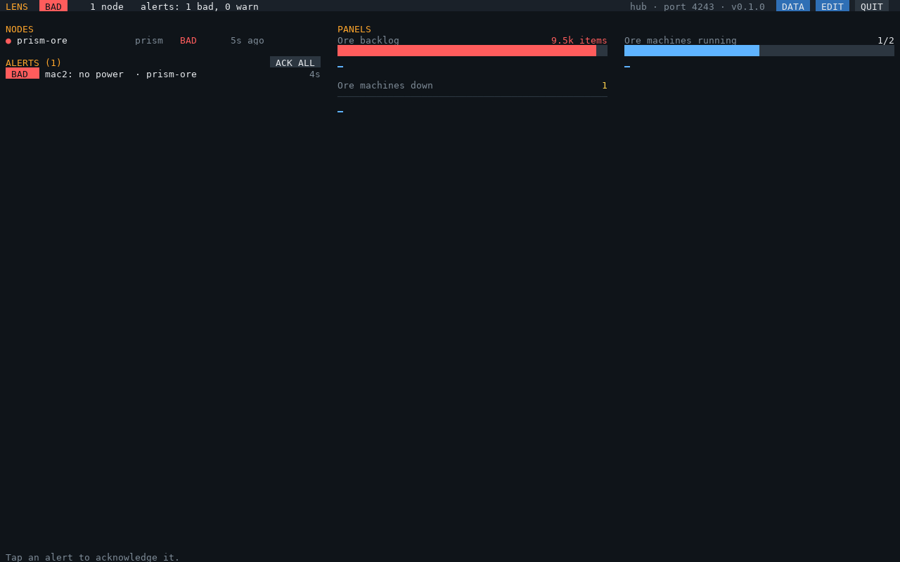
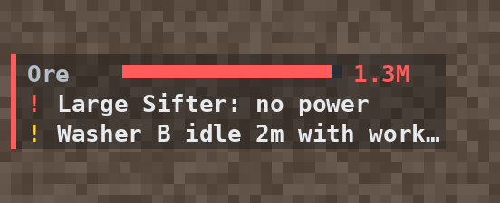

# LENS

**Live Engineering & Network Status.** Base-wide monitoring for **GregTech: New Horizons** on
**OpenComputers**: one screen, and an AR glasses HUD, for everything your base's computers know.

[PRISM](https://github.com/aharabedian/prism) splits one stream of items into many machines; LENS does the
opposite and gathers what every system knows into one place. Each system (an **agent**: a PRISM router
today, power and more to come) pushes its health, metrics and alerts over the network. The **hub** collects
them, notices when one goes quiet, and shows the base at a glance.



## Features

- **One dashboard for the base**: every agent's health and when it last reported, every alert in one list
  (tap to acknowledge), and panels you choose: bars, values and sparklines.
- **AR glasses HUD** (OC Glasses): your bars and the newest alerts in a corner of your view. One Glasses
  Terminal per player gives each their own HUD, set up from the dashboard.
  
- **Stale detection**: an agent that stops reporting (crashed, unloaded chunk, out of range) raises an alert.
- **Queries and rules**: Prometheus-style queries (`sum(prism_machine_state{node="prism-ore", state="running"})`)
  for panels, HUD bars and the hub's own alerts, including ones across systems.
- **Guided setup**: `lens-setup` finds the agents on the network and offers their panels.
- **Watches, never controls**: agents keep working without the hub, and the hub never sends them commands.
- **One-command install and updates** from GitHub.

## Requirements

- OpenComputers as shipped in GTNH, on the Lua 5.3 architecture.
- A **hub computer** with a tier 3 GPU and screen (tier 2 works), a keyboard and a network card that reaches
  the agents (wireless, wired, or linked cards across dimensions).
- An **agent**: [PRISM](https://github.com/aharabedian/prism) 1.2.0 or newer.
- Optional: an **OC Glasses** Glasses Terminal for the HUD; an Internet Card for `lens-update`.

## Install

On the hub computer, with an Internet Card:

```
wget -f https://raw.githubusercontent.com/aharabedian/lens/main/src/lens-update.lua /home/lens-update.lua
/home/lens-update
```

## Quick start

1. On each PRISM router, run `prism-setup` and turn on **LENS monitoring** (port 4243, a name per router),
   then restart `prism`.
2. On the hub, run **`lens-setup`**: it finds the routers and offers their panels and HUD bars.
3. Run **`lens-hub`** (or reboot, if you chose start on boot).

Details: **[docs/setup.md](docs/setup.md)**.

## Documentation

| Doc | What's in it |
|---|---|
| [docs/setup.md](docs/setup.md) | Hardware, install, connecting agents, first run, updating |
| [docs/hub.md](docs/hub.md) | The dashboard, the AR glasses HUD, and every `lens-hub.cfg` option |
| [docs/queries.md](docs/queries.md) | The query language for panels, bars and rules |
| [docs/troubleshooting.md](docs/troubleshooting.md) | Common problems and fixes |
| [docs/telemetry.md](docs/telemetry.md) | The `lens/1` protocol, for writing an agent |
| [docs/architecture.md](docs/architecture.md) | Modules, programs, and what's verified in game |
| [tests/README.md](tests/README.md) | The mocked test suite |
| [CONTRIBUTING.md](CONTRIBUTING.md) | Development workflow and conventions |

## Roadmap

- **Power agent**: Lapotronic Supercapacitors, IC2 reactors and other GTNH power, with its own control
  (a separate project, like PRISM).
- **History graphs** on the dashboard.

## Development

```
make dev      # install luacheck and a Python venv for rendering screens (once)
make check    # lint + tests
make screens  # render the screens and HUDs the tests draw into build/screens/*.png
```

MIT licensed. See [CONTRIBUTING.md](CONTRIBUTING.md).
