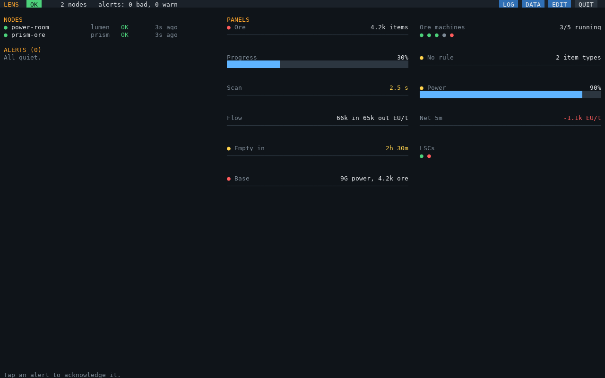

# Examples

Views to copy, using what PRISM and LUMEN send. Each works as a panel and as a HUD bar or text line.

- **On the screen:** EDIT → **+ NEW**, fill in the fields (status rules with **+ RULE**), SAVE; then **HUD** to put
  it in your HUD (BAR or TEXT).
- **In `lens-hub.cfg`:** under `panels = { ... }`, or as a HUD element with `kind = "text"` or `"bar"` added.

Replace `prism-ore` with your router's LENS node name (DATA lists every node and metric). Every example here is
checked by the tests: it loads as written, and the views below show what they say.



## Ore processing

**The line at a glance:** the backlog, and one dot that says how it's going.

```lua
{ label = "Ore", value = 'sum(prism_backlog_items{node="prism-ore"})', unit = "items",
  status = {
    { "bad",  'sum(prism_machine_state{node="prism-ore", state="down"}) > 0' },     -- a machine is down
    { "warn", 'max(prism_stalled_seconds{node="prism-ore"}) > 60' },                 -- stalled a minute
    { "warn", "$value > 50000" },                                                    -- piling up
    { "good", 'sum(prism_machine_state{node="prism-ore", state="running"}) > 0' },  -- running
  } },                                                                               -- else gray: nothing to do
```

**Machines running, with a dot each:** `3/5 running` and `● ● ● ○ ●`.

```lua
{ label = "Ore machines", text = "{r}/{n} running",
  values = { r = 'sum(prism_machine_state{node="prism-ore", state="running"})',
             n = 'count(prism_machine_state{node="prism-ore", state="running"})' },
  dots = 'prism_machine_state{node="prism-ore"}' },
```

**How far along the recipes are:** a bar of the machines' average progress.

```lua
{ label = "Progress", value = 'avg(prism_machine_progress_ratio{node="prism-ore"})', format = "percent" },
```

**Items with nowhere to go:** only shown while there are any.

```lua
{ label = "No rule", text = "{value} item types", value = "sum(prism_unassigned_types)",
  status = { { "warn", "$value > 0" } }, when = "sum(prism_unassigned_types) > 0" },
```

**Is the router keeping up:** how long a scan takes, yellow over 2 s, red over 5 s.

```lua
{ label = "Scan", value = 'max(prism_scan_seconds{node="prism-ore"})', unit = "s", warnAbove = 2, badAbove = 5 },
```

## Power

**How full, and which way it's going:** a bar, with a dot for the trend over the last hour.

```lua
{ label = "Power", value = "sum(lumen_stored_eu) / sum(lumen_capacity_eu)", format = "percent",
  status = {
    { "bad",  "$value < 0.1" },                     -- nearly empty
    { "warn", "min(lumen_drain_seconds) < 14400" }, -- empty within 4 hours, at the hour's average
    { "good", "sum(lumen_net_1h_eut) > 0" },        -- filling
  } },
```

**In and out on one line:** `66k in 65k out EU/t`.

```lua
{ label = "Flow", text = "{i} in {o} out EU/t",
  values = { i = "sum(lumen_input_eut)", o = "sum(lumen_output_eut)" } },
```

**Net, green or red:** the 5-minute average, signed.

```lua
{ label = "Net 5m", value = "sum(lumen_net_5m_eut)", unit = "EU/t", format = "signed", color = "sign" },
```

**Time left, only while draining:** red under an hour.

```lua
{ label = "Empty in", value = "min(lumen_drain_seconds)", format = "duration",
  status = { { "bad", "$value < 3600" }, { "warn", "$value < 14400" } }, color = "status",
  when = "count(lumen_drain_seconds) > 0" },
```

**Time to full, only while charging:**

```lua
{ label = "Full in", value = "min(lumen_full_seconds)", format = "duration",
  when = "count(lumen_full_seconds) > 0" },
```

**Every LSC, a dot each:** green when it can be read, red when not (unloaded chunk, broken adapter).

```lua
{ label = "LSCs", dots = "lumen_lsc_up", by = "lsc" },
```

## Across systems

**The whole base in one dot:** red if any LSC can't be read or any ore machine is down, yellow if power is low
or the ore line has stalled, green otherwise.

```lua
{ label = "Base", text = "{p} power, {o} ore", format = "auto",
  values = { p = "sum(lumen_stored_eu)", o = 'sum(prism_backlog_items{node="prism-ore"})' },
  status = {
    { "bad",  'sum(lumen_lsc_up) < count(lumen_lsc_up) or sum(prism_machine_state{node="prism-ore", state="down"}) > 0' },
    { "warn", 'sum(lumen_stored_eu) / sum(lumen_capacity_eu) < 0.25 or max(prism_stalled_seconds{node="prism-ore"}) > 60' },
    { "good", "1" },
  } },
```

**Power low while the ore line is busy:** a warning line that only appears when both are true.

```lua
{ label = "Ore on low power", text = "{p} full", format = "percent",
  values = { p = "sum(lumen_stored_eu) / sum(lumen_capacity_eu)" },
  status = { { "warn", "1" } },
  when = 'sum(lumen_stored_eu) / sum(lumen_capacity_eu) < 0.25 and sum(prism_backlog_items{node="prism-ore"}) > 0' },
```

The same condition as a hub alert, so it beeps and shows in LOG (in `lens-hub.cfg`, under `rules`):

```lua
{ id = "ore-low-power", level = "warn", text = "Ore line busy on low power",
  when = 'sum(lumen_stored_eu) / sum(lumen_capacity_eu) < 0.25 and sum(prism_backlog_items{node="prism-ore"}) > 0',
  ["for"] = 120 },
```

## HUD layouts

Presets (HUD → **+**) let each player keep a few of these and switch.

**Base:** a compact block top-right; alerts below the lines.

```lua
hud = { blocks = {
  { anchor = "top-right", elements = {
    { kind = "bar", label = "Power", value = "sum(lumen_stored_eu) / sum(lumen_capacity_eu)", format = "percent",
      warnBelow = 0.25, badBelow = 0.1 },
    { kind = "text", label = "Ore", value = 'sum(prism_backlog_items{node="prism-ore"})', unit = "items",
      status = { { "bad", 'sum(prism_machine_state{node="prism-ore", state="down"}) > 0' },
                 { "good", 'sum(prism_machine_state{node="prism-ore", state="running"}) > 0' } } },
    { kind = "gap" },
    { kind = "alerts", count = 3 },
  } },
} },
```

**Out mining:** nothing but trouble. A small block top-center that is empty (just `LENS OK`) until something
needs you back.

```lua
hud = { blocks = {
  { anchor = "top", width = 140, elements = {
    { kind = "text", label = "Power", value = "sum(lumen_stored_eu) / sum(lumen_capacity_eu)", format = "percent",
      color = "status", status = { { "bad", "$value < 0.1" }, { "warn", "$value < 0.25" } },
      when = "sum(lumen_stored_eu) / sum(lumen_capacity_eu) < 0.25" },
    { kind = "alerts", count = 2 },
  } },
} },
```

**Two corners:** power top-right, the ore line bottom-left (clear of a minimap).

```lua
hud = { blocks = {
  { anchor = "top-right", elements = {
    { kind = "bar", label = "Power", value = "sum(lumen_stored_eu) / sum(lumen_capacity_eu)", format = "percent" },
    { kind = "text", label = "Net 5m", value = "sum(lumen_net_5m_eut)", unit = "EU/t", format = "signed", color = "sign" },
  } },
  { anchor = "bottom-left", y = -40, elements = {
    { kind = "text", label = "Ore line", dots = 'prism_machine_state{node="prism-ore"}' },
    { kind = "alerts", count = 3 },
  } },
} },
```

## Tips

- **Order status rules from worst to best:** the first true one wins.
- **`$value`** keeps a rule short and follows the view's query when you change it.
- **A rule of `"1"`** is always true: the color to fall back on (`{ "good", "1" }` last means "green unless...").
- **`when`** keeps a HUD quiet: lines that only appear when they matter.
- **DATA** builds the queries: tap a metric, its labels and a function, then copy the query into a rule.
