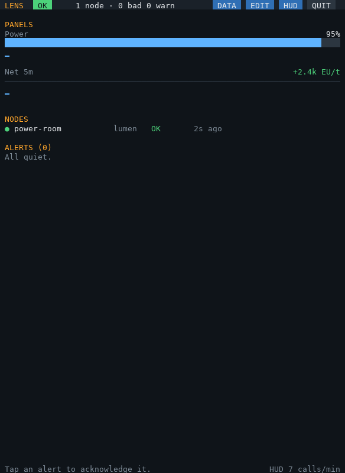
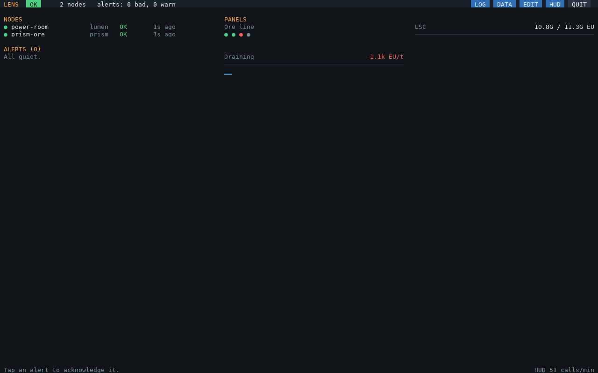
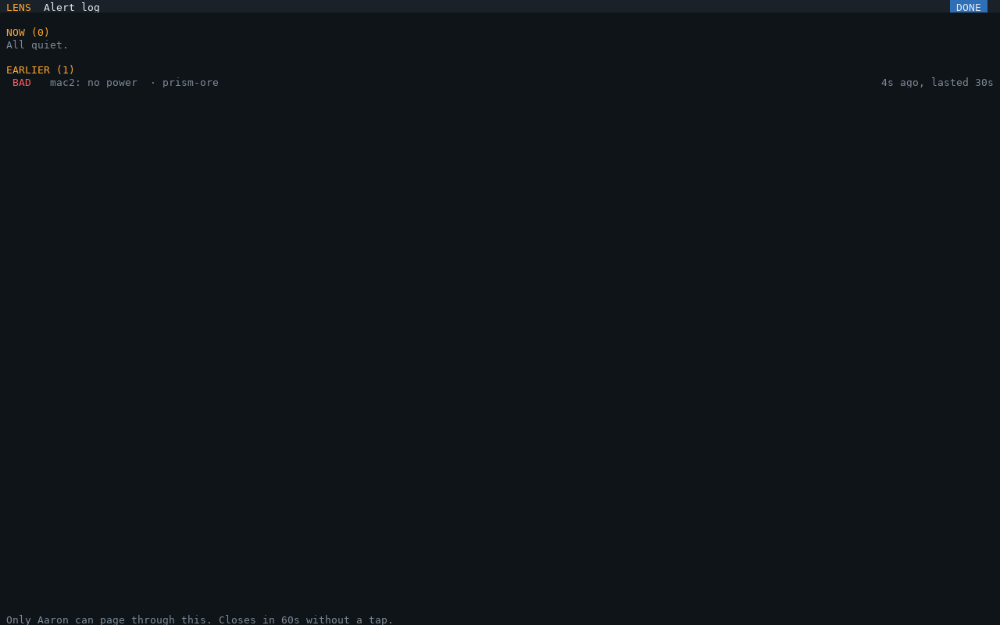
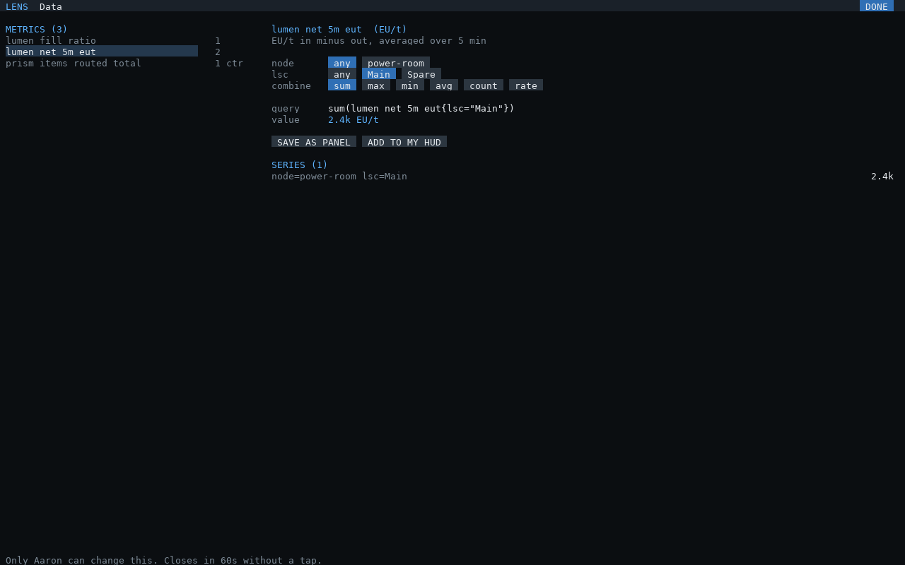
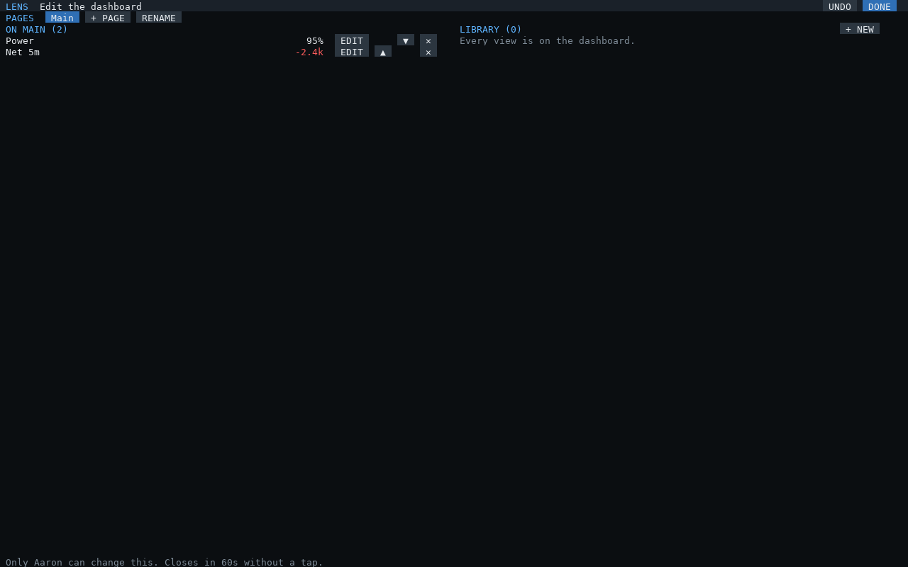
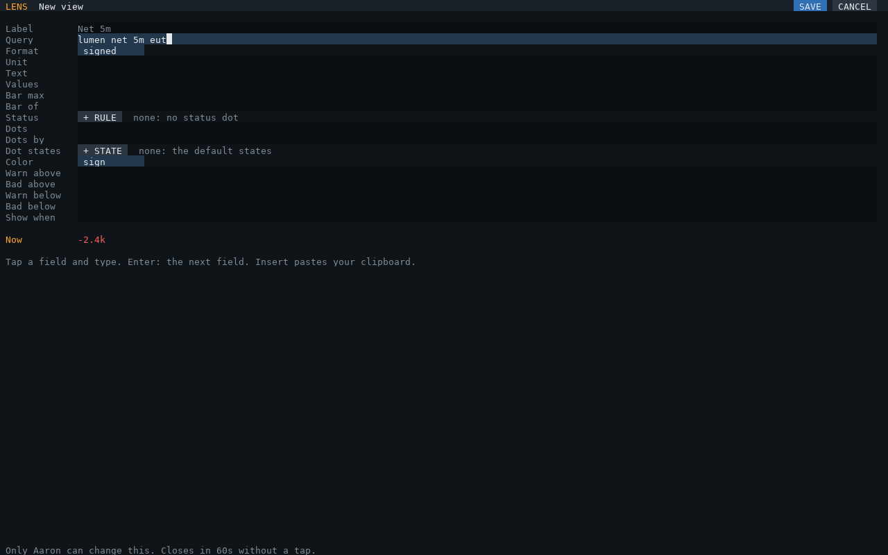
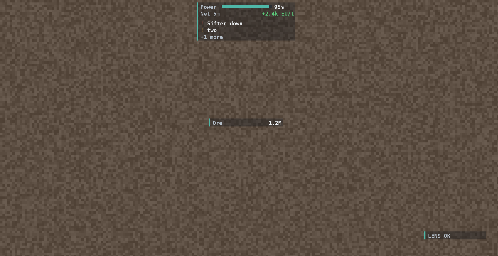

# The hub

`lens-hub` listens for every agent in the base and shows them on one screen: overall health, each node,
every alert, and the panels you configure. It only watches; control stays in each system's own UI.


Install, connecting agents and the first run: [setup.md](setup.md). Problems: [troubleshooting.md](troubleshooting.md).

## The screen

| Part | Shows |
|---|---|
| Header | Overall health (the worst of the critical nodes), node count, alert counts, the hub's name, port and version, **LOG** ([below](#the-alert-log)), **DATA** ([below](#the-data-page)), **EDIT** ([editing on the screen](#editing-on-the-screen)), **HUD** (with a Glasses Terminal), QUIT |
| NODES | Each agent: health (`STALE` when it stopped reporting), role, when it last reported |
| ALERTS | Every active alert, `BAD` first, then oldest. **Tap one to acknowledge it**; ACK ALL acknowledges every alert. An acknowledged alert stays listed (✓, dimmed) until it clears, and comes back unacknowledged if it gets worse |
| Page tabs | With more than one page: tap one to show its panels (anyone may) |
| PANELS | The shown page's panels: label, value, a bar for `max` / `of` / `percent` (or state dots), and a sparkline of its history (tier 3) |

On a screen narrower than 120 columns, panels, nodes and alerts stack; on a tall one (40 rows or more)
panels keep their sparklines. The hub beeps when a new `BAD` alert appears. It redraws only what changed
(about 2 GPU calls a second when nothing happens).

**Screen shape:** by default (`resolution = "fit"`) the hub picks the resolution that matches the screen's
shape in blocks, so text fills it with no empty borders. Characters are twice as tall as they are wide, so a
3 wide, 4 tall screen gets 73 × 50:




## `lens-hub.cfg`

`lens-setup` writes it (and keeps your edits when you run it again); every key is optional.
`lens-hub.example.cfg` is an annotated example.

| Key | Default | Meaning |
|---|---|---|
| `node` | `"hub"` | This hub's name. Its rule alerts are listed under it |
| `port` | `4243` | The LENS port: every agent's `lensPort`. Keep it apart from PRISM's control port |
| `token` | `nil` | Shared secret: every agent sends the same (PRISM: `lensToken`). Messages without it are ignored |
| `staleAfter` | `3` | Missed snapshots before a node counts as stopped reporting (a `BAD` alert) |
| `beep` | `true` | Beep when a new `BAD` alert appears |
| `sample` | `10` | Seconds between sparkline samples |
| `editors` | `nil` | Player names who may use EDIT: `{ "Steve", "Alex" }`. `nil`: anyone |
| `resolution` | `"fit"` | `"fit"`: match the screen's shape (see above). `"max"`: the GPU's largest. `{ width, height }`: your own, e.g. `{ 80, 25 }` for bigger text |
| `nonCritical` | `{}` | Node names whose silence is only a warning and that don't count towards overall health |
| `panels` | `{}` | See below |
| `hud` | `{}` | The AR glasses HUD, see [below](#ar-glasses-hud); `false` turns it off |
| `rules` | `{}` | The hub's own alerts, see below |

A mistake in the file stops `lens-hub` with the panel or rule named: `panel 2 (Ore): value: expected ) at 14`.

### Panels

```lua
{ label = "Ore backlog", value = 'sum(prism_backlog_items{node="prism-ore"})', max = 10000, unit = "items",
  warnAbove = 5000, badAbove = 9000 },
```

| Key | Meaning |
|---|---|
| `label` | Name shown on the panel (required) |
| `value` | A [query](queries.md). Required unless the view has `text` or `dots` |
| `max` | Draw a bar of `value / max` |
| `of` | A query: show `value/of` and a bar of the fraction. Use `count(...)` of a state series for "how many machines" |
| `format` | How the value reads: `"auto"` (`4.2k`, `1.5M`, `3G`; the default), `"percent"` (value is 0..1, shown as %, with a bar; `percent = true` does the same), `"duration"` (seconds, as `2h 05m`), `"signed"` (`+2.4k`, `-300`) |
| `unit` | Text after the value |
| `color` | `"thresholds"` (the default: the four keys below), `"sign"` (green above zero, red below), `"none"` |
| `warnAbove`, `badAbove`, `warnBelow`, `badBelow` | Color the value and bar yellow or red past these |
| `text`, `values` | **Several values in one line**: `text = "{s} / {c} EU"` with `values = { s = "sum(lumen_stored_eu)", c = "sum(lumen_capacity_eu)" }`. Each `{name}` is formatted with `format`; `{value}` and `{of}` are the view's own |
| `dots`, `by`, `idle` | **State dots**: a [selector](queries.md) such as `'prism_machine_state{node="prism-ore"}'`, one dot per `by` label (default `machine`). Each series' `state` label: running green, down red, idle dim (`idle = "warn"`: yellow), anything else yellow; series without a `state` label are green above 0, red at 0 (`lumen_lsc_up`, `by = "lsc"`). **A dot for several series** (`by = "process"`: the whole line) is red if any is down, else green if any runs, else yellow if any is something else, else idle |
| `when` | **Show only while** this query is true (non-zero): `when = "lumen_net_5m_eut < 0"`. The EDIT page still lists it, as `hidden` |

A query with no data shows `–`. A panel is a **view**: the same keys make a HUD bar or text (a view with dots
shows its dots in either; in the HUD, with its value on the same row: `Ore backlog ● 4.2k items`).

```lua
{ label = "Ore line", dots = 'prism_machine_state{node="prism-ore"}' },                 -- a dot per machine
{ label = "Ore backlog", value = 'sum(prism_backlog_items{node="prism-ore"})', unit = "items",
  dots = 'prism_machine_state{node="prism-ore"}', by = "process", idle = "warn" },   -- one dot, and the count
{ label = "LSC", text = "{s} / {c} EU", values = { s = "sum(lumen_stored_eu)", c = "sum(lumen_capacity_eu)" } },
{ label = "Draining", value = "lumen_net_5m_eut", unit = "EU/t", format = "signed", color = "sign",
  when = "lumen_net_5m_eut < 0" },
```



## The alert log

Tap **LOG** for what happened while you were away: alerts happening **now** (and for how long), then the ones
that have **ended**, newest first, with when and how long they lasted (the worst level each reached). The hub
keeps the last 100 that ended, in memory: a restart starts the log over.



## The DATA page

Tap **DATA** to see everything the agents send and build a query without writing one:



1. **Pick a metric** from the list: every metric from every agent that's reporting, with how many series it has
   (`ctr` marks a counter). Long lists page with ◀ ▶.
2. Its unit, help and **every series** with its labels and value (counters also show their rate) appear.
3. **Tap label values** to narrow it down (`any` clears one); the other labels only offer values that still
   match. **Tap a function** (`sum`, `max`, `min`, `avg`, `count`, `rate`) to combine the series. Counters start
   on `rate`.
4. The **query** and its **value** follow every tap.
5. **SAVE AS PANEL** opens it in the view editor (query, a label and the unit filled in) and puts it on the
   dashboard when saved. **ADD TO MY HUD** does the same for your own HUD (a text line in your first block).
   After saving you're back on the DATA page as you left it.

SAVE AS PANEL follows `editors`; anyone can add to their own HUD. On a narrow screen the list and a metric take
turns (◀ METRICS goes back). The [query language](queries.md) is still there for anything the taps can't build:
edit the query in the view editor.

## Editing on the screen

Tap **EDIT** to change the dashboard and the **library** of views. Everything you change here is saved in
**`/home/lens-board.cfg`** (next to lens-hub.cfg), which only the hub writes; lens-hub.cfg is never touched.



| | |
|---|---|
| PAGES | The dashboard's pages (up to 8): tap one to edit it; **+ PAGE** adds one and asks for its name; **RENAME** (typed); **DELETE PAGE** (not the last; its panels leave the dashboard, the views stay in the library) |
| ON *page* | That page's panels with their values: **EDIT** opens the view, ▲ ▼ order, ✕ takes it off (it stays in the library) |
| LIBRARY | Views not on that page: **+** puts one on, **EDIT** opens it, **+ NEW** makes one (on that page). `cfg` marks a view from lens-hub.cfg; `cfg*` one changed here |
| UNDO | Takes back the last change to views or panels (up to 20) |

**A view** (the same keys as a [panel](#panels)), with its value previewed as you type:



Tap a field and type: **a keyboard attached to the hub's screen** is needed for that (Enter goes to the next
field, Insert pastes your clipboard). **Values** is typed on one line: `s=sum(lumen_stored_eu); c=sum(lumen_capacity_eu)`. Format and Color cycle when tapped. SAVE checks the view like lens-hub.cfg
would and says what's wrong. A new view goes on the dashboard, and every view is offered in each player's HUD
editor.

- Views from lens-hub.cfg can be changed here (your version is kept in lens-board.cfg; **BACK TO lens-hub.cfg**
  drops it) but keep their label and can't be deleted.
- Renaming a view moves the dashboard and players' HUDs along with it.
- A panel later added to lens-hub.cfg (by lens-setup, say) appears on the first page once; one you took off
  stays off.
- One editor is open at a time, for the player who opened it; only their taps and keys count, and it closes
  after a minute without one. `editors` in lens-hub.cfg limits who may open EDIT.

### Rules

```lua
{ id = "ore-backlog", level = "warn", text = "Ore backlog over 9k for 5 minutes",
  when = 'sum(prism_backlog_items{node="prism-ore"}) > 9000', ["for"] = 300 },
```

`when` is a query that is true when non-zero; the alert fires once it has been true for `for` seconds
(default 0). Missing data is false, so a node going quiet raises its stale alert instead.

## AR glasses HUD

With an **OC Glasses** Glasses Terminal attached to the hub computer, `lens-hub` draws a HUD in the view of
everyone wearing glasses linked to that terminal: one or more **blocks**, each a small list of bars, text lines
and the newest unacknowledged alerts, with a thin strip down the left in the base's overall health color.



Acknowledge alerts on the dashboard and they leave the HUD. Widgets are made once and only changed values are
sent; the dashboard's footer shows how many calls the HUD made in the last minute (`HUD n calls/min`; 0 when
nothing changes). If a terminal fails, the dashboard keeps running and shows `HUD: <error>` in its footer.

`hud` in lens-hub.cfg is everyone's default; each player can change their own on the dashboard
([below](#a-hud-for-each-player)).

```lua
hud = {
  blocks = {
    { anchor = "top-right", elements = {
      { kind = "bar", label = "Power", value = "lumen_stored_eu / lumen_capacity_eu", format = "percent", warnBelow = 0.25 },
      { kind = "text", label = "Net 5m", value = "lumen_net_5m_eut", unit = "EU/t", format = "signed", color = "sign" },
      { kind = "alerts", count = 3 },
    } },
    { anchor = "bottom-left", x = 4, y = -60, elements = {
      { kind = "bar", label = "Ore", value = 'sum(prism_backlog_items{node="prism-ore"})', max = 10000 },
    } },
  },
},
```

| `hud` key | Default | Meaning |
|---|---|---|
| `blocks` | | The blocks, below. Without `blocks`, the first form still works: `anchor`, `x`, `y` (margins), `width`, `alerts`, `bars` make one block of the bars, then the alerts |
| `scale` | `1` | Text and row size: 1 is about chat-text size, 2 doubles it (double `width` too) |
| `alpha` | `0.35` | Backdrop opacity, 0 for none |
| `colors` | `"float"` | `"float"` (0..1, what OC Glasses takes) or `"byte"` (0..255) for other glasses mods |

| Block key | Default | Meaning |
|---|---|---|
| `anchor` | `"top-right"` | The point it hangs from: `"top-left"`, `"top"`, `"top-right"`, `"left"`, `"center"`, `"right"`, `"bottom-left"`, `"bottom"`, `"bottom-right"` |
| `x`, `y` | 4 in from the edges the anchor touches | GUI pixels from the anchor, **right and down positive** (3 screen pixels each at GUI scale 3). A block never leaves the view |
| `width` | `160` | GUI pixels; text takes about 5 per character at scale 1 |
| `elements` | `{}` | Top to bottom: `{ kind = "bar", ...a view }`, `{ kind = "text", ...a view }` (label, then the value on the right), `{ kind = "alerts", count = 3 }`, `{ kind = "gap" }` (half a row) |

A view is a panel's keys ([panels](#panels)): `format` and `color` work the same, so `color = "sign"` makes a net
flow green or red. The hub learns each wearer's view size when they put the glasses on (until then it assumes
854 x 480, a 1440p window at GUI scale 3).

### A HUD for each player

A Glasses Terminal shows the same HUD to everyone linked to it: OC Glasses can't show a widget to just one
player. For HUDs of their own, **each player links their glasses to their own terminal**, all attached to the
hub computer. The hub drives every terminal and learns who wears which when they put their glasses on
(`glasses_on`). Each terminal is placed using its own wearer's view size.

**Changing your HUD:** tap **HUD** in the dashboard's header. The editor opens for whoever tapped, and only
their taps change anything:


| | |
|---|---|
| HUDS | Your **presets**: named HUDs, one shown at a time. Tap one to switch to it; **+** copies the one you're on and asks for a name; **RENAME** (typed, with a keyboard), **DELETE** (not the last) |
| BLOCKS | A tab per block; **+** adds one, REMOVE drops the one you're editing |
| IN BLOCK n | Its elements, in order: tap one to remove it, **BAR / TEXT** switches how it shows, ▲ ▼ order. Below: every view in the library you could add, **+ ALERTS** (then − / + for how many) and **+ GAP** |
| POSITION | The anchor grid (↖ ↑ ↗ ← • → ↙ ↓ ↘), then ◀ ▲ ▼ ▶ to nudge by the step (tap it: 1, 8 or 32 px). Watch the glasses as you tap |
| Width, Size | The block's width; text size for all your blocks |
| BACK TO DEFAULT | Drops this HUD's settings: it shows `hud` from lens-hub.cfg again |
| DONE | Back to the dashboard (it also closes after a minute without a tap) |

Everyone starts with one HUD, `main`; switch presets for different jobs (base, mining, power). Changes show
in your glasses straight away and are saved in `lens-board.cfg` with the rest of what's edited
on the screen (an earlier `lens-hud.cfg` is read into it once). A player with no settings there, or a terminal
whose wearer isn't known yet, shows `hud` from lens-hub.cfg. The views offered are the whole library: make new
ones with EDIT.
