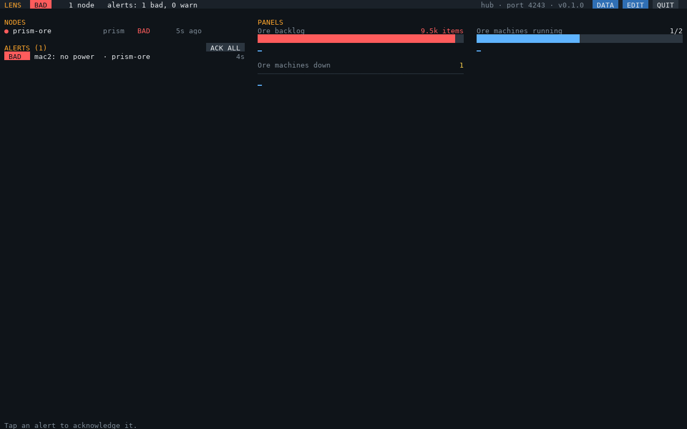
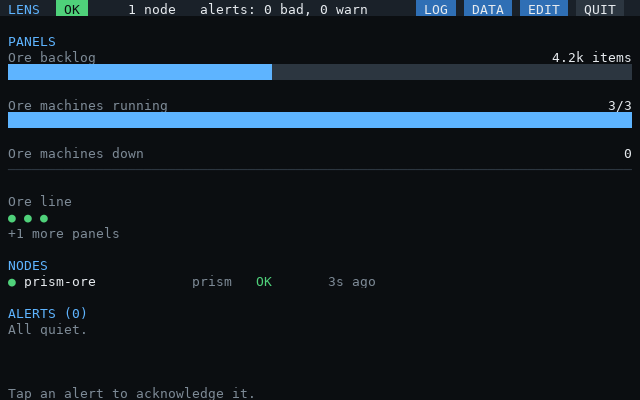
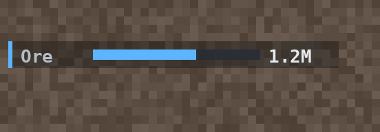
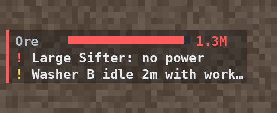
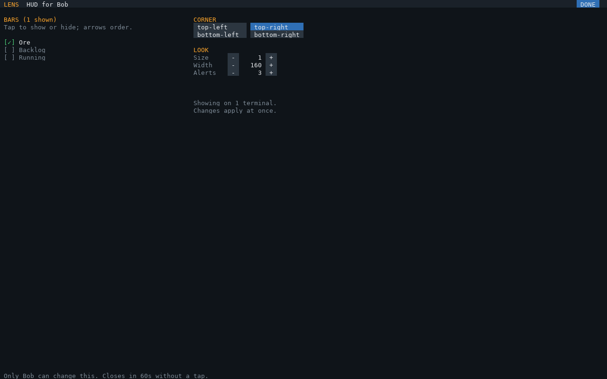

# The hub

`lens-hub` listens for every agent in the base and shows them on one screen: overall health, each node,
every alert, and the panels you configure. It only watches; control stays in each system's own UI.



Install, connecting agents and the first run: [setup.md](setup.md). Problems: [troubleshooting.md](troubleshooting.md).

## The screen

| Part | Shows |
|---|---|
| Header | Overall health (the worst of the critical nodes), node count, alert counts, the hub's name, port and version, QUIT |
| NODES | Each agent: health (`STALE` when it stopped reporting), role, when it last reported |
| ALERTS | Every active alert, `BAD` first, then oldest. **Tap one to acknowledge it**; ACK ALL acknowledges every alert. An acknowledged alert stays listed (✓, dimmed) until it clears, and comes back unacknowledged if it gets worse |
| PANELS | Your panels: label, value, a bar for `max` / `of` / `percent`, and a sparkline of its history (tier 3) |

On a screen narrower than 120 columns, panels, nodes and alerts stack. The hub beeps when a new `BAD`
alert appears. It redraws only what changed (about 2 GPU calls a second when nothing happens).



## `lens-hub.cfg`

`lens-setup` writes it (and keeps your edits when you run it again); every key is optional.
`lens-hub.example.cfg` is an annotated example.

| Key | Default | Meaning |
|---|---|---|
| `node` | `"hub"` | This hub's name. Its rule alerts are listed under it |
| `port` | `4243` | The LENS port: every agent's `lensPort`. Keep it apart from PRISM's control port |
| `token` | `nil` | Shared secret: every agent sends the same (PRISM: `lensToken`). Messages without it are ignored |
| `staleAfter` | `3` | Missed snapshots before a node counts as stopped reporting (a `BAD` alert) |
| `beep` | `true` | Beep when a new `BAD` alert appears |
| `sample` | `10` | Seconds between sparkline samples |
| `nonCritical` | `{}` | Node names whose silence is only a warning and that don't count towards overall health |
| `panels` | `{}` | See below |
| `hud` | `{}` | The AR glasses HUD, see [below](#ar-glasses-hud); `false` turns it off |
| `rules` | `{}` | The hub's own alerts, see below |

A mistake in the file stops `lens-hub` with the panel or rule named: `panel 2 (Ore): value: expected ) at 14`.

### Panels

```lua
{ label = "Ore backlog", value = 'sum(prism_backlog_items{node="prism-ore"})', max = 10000, unit = "items",
  warnAbove = 5000, badAbove = 9000 },
```

| Key | Meaning |
|---|---|
| `label` | Name shown on the panel (required) |
| `value` | A [query](queries.md) (required) |
| `max` | Draw a bar of `value / max` |
| `of` | A query: show `value/of` and a bar of the fraction. Use `count(...)` of a state series for "how many machines" |
| `percent` | `true` when `value` is 0..1: show it as a percentage, with a bar |
| `unit` | Text after the value |
| `warnAbove`, `badAbove`, `warnBelow`, `badBelow` | Color the value and bar yellow or red past these |

Values show as `4.2k`, `1.5M`, `3G`. A query with no data shows `–`.

### Rules

```lua
{ id = "ore-backlog", level = "warn", text = "Ore backlog over 9k for 5 minutes",
  when = 'sum(prism_backlog_items{node="prism-ore"}) > 9000', ["for"] = 300 },
```

`when` is a query that is true when non-zero; the alert fires once it has been true for `for` seconds
(default 0). Missing data is false, so a node going quiet raises its stale alert instead.

## AR glasses HUD

With an **OC Glasses** Glasses Terminal attached to the hub computer, `lens-hub` also draws a small block in
the top-right of the view of everyone wearing glasses linked to that terminal (one terminal per player
gives each their own HUD, [below](#a-hud-for-each-player)): the bars you choose, then the newest
unacknowledged alerts, with a thin strip down the left in the base's overall health color.

 

Acknowledge alerts on the dashboard and they leave the HUD. Widgets are made once and only changed values are
sent; the dashboard's footer shows how many calls the HUD made in the last minute (`HUD n calls/min`; 0 when
nothing changes). If the terminal fails, the dashboard keeps running and shows `HUD: <error>` in its footer.

```lua
hud = {
  bars = {
    { label = "Ore", value = 'sum(prism_backlog_items{node="prism-ore"})', max = 10000, warnAbove = 5000, badAbove = 9000 },
  },
},
```

| `hud` key | Default | Meaning |
|---|---|---|
| `bars` | `{}` | Bars, in the same form as [panels](#panels): `label`, `value`, `max` / `of` / `percent`, thresholds. The fill turns amber or red past `warn…` / `bad…` |
| `alerts` | `3` | Unacknowledged alerts shown, then `+N more` |
| `anchor` | `"top-right"` | The corner the block sits in: `"top-right"`, `"top-left"`, `"bottom-right"` or `"bottom-left"`. The hub learns each wearer's view size when they put the glasses on (until then it assumes 854 x 480, a 1440p window at GUI scale 3) |
| `x`, `y` | `4`, `4` | Margins from that corner, in GUI pixels (3 screen pixels each at GUI scale 3) |
| `width` | `160` | Width of the block, in GUI pixels; text takes about 5 per character at scale 1 |
| `scale` | `1` | Text and row size: 1 is about chat-text size, 2 doubles it (double `width` too) |
| `alpha` | `0.35` | Backdrop opacity, 0 for none |
| `colors` | `"float"` | `"float"` (0..1, what OC Glasses takes) or `"byte"` (0..255) for other glasses mods |

### A HUD for each player

A Glasses Terminal shows the same HUD to everyone linked to it: OC Glasses can't show a widget to just one
player. For HUDs of their own, **each player links their glasses to their own terminal**, all attached to the
hub computer. The hub drives every terminal and learns who wears which when they put their glasses on
(`glasses_on`). Each terminal is placed using its own wearer's view size.

**Changing your HUD:** tap **HUD** in the dashboard's header. The editor opens for whoever tapped, and only
their taps change anything:



| | |
|---|---|
| Bars | Tap one to show or hide it; ▲ ▼ order the ones shown. The choices are `hud.bars` and every panel |
| Corner | Where the block sits |
| Size, Width, Alerts | `scale` (0.5 to 3), `width` (100 to 400 px) and how many alerts |
| BACK TO DEFAULT | Drops your settings: you get `hud` from lens-hub.cfg again |
| DONE | Back to the dashboard (it also closes after a minute without a tap) |

Changes show in your glasses straight away and are saved in **`/home/lens-hud.cfg`** (next to lens-hub.cfg),
one line per player. Only the hub writes it; lens-setup and lens-hub.cfg are untouched. A player with no
settings there, or a terminal whose wearer isn't known yet, shows `hud` from lens-hub.cfg. New panels and
queries are still added in lens-setup or lens-hub.cfg.
