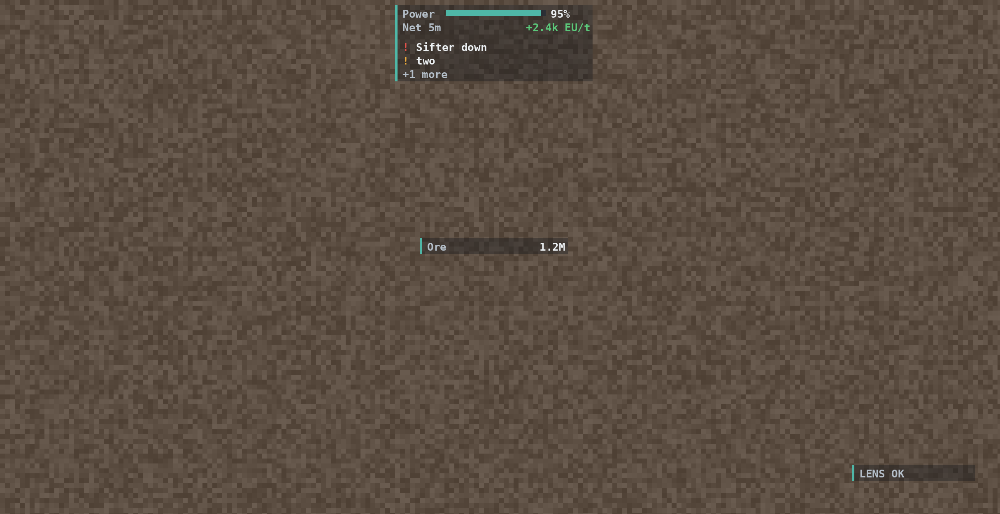
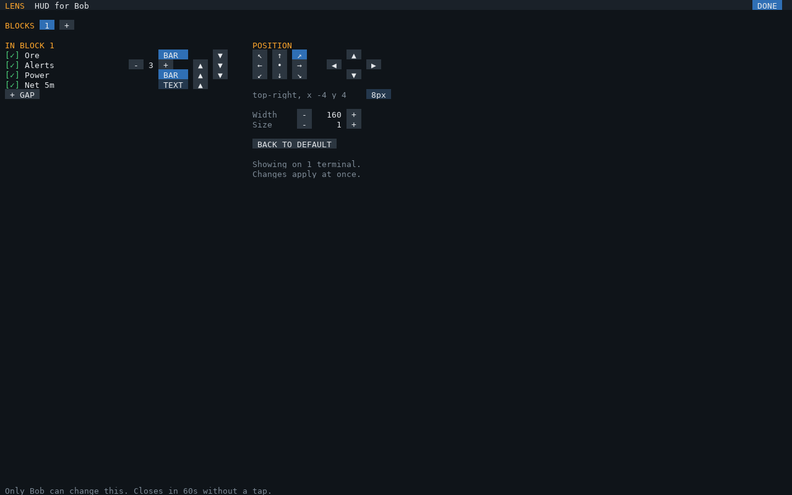

# The AR glasses HUD

With an **OC Glasses** Glasses Terminal attached to the hub computer, `lens-hub` draws a HUD in the view of
everyone wearing glasses linked to it: one or more **blocks**, each a small list of bars, text lines, dots and
the newest unacknowledged alerts, with a thin strip down the left in the base's overall health color.



Widgets are made once and only changed values are sent: the dashboard's footer shows the HUD's calls in the last
minute (`HUD n calls/min`; about 0 when nothing changes). If a terminal fails, the dashboard keeps running and
shows `HUD: <error>` in its footer. Acknowledge alerts on the dashboard and they leave the HUD.

## A HUD for each player

A Glasses Terminal shows the same HUD to everyone linked to it: OC Glasses can't show a widget to just one
player. For HUDs of their own, **each player links their glasses to their own terminal**, all attached to the
hub computer. The hub learns who wears which when they put their glasses on, and places each terminal's HUD for
its wearer's view size.

`hud` in `lens-hub.cfg` is everyone's default. Each player changes their own on the dashboard (tap **HUD**), and
keeps up to 8 named HUDs (**presets**) to switch between: one for the base, one for mining, one for power. Everyone
starts with one, `main`.

## The HUD editor

Tap **HUD** in the dashboard's header. It opens for whoever tapped, and only their taps change anything:



| | |
|---|---|
| HUDS | Your presets: tap one to switch to it; **+** copies the one you're on and asks for a name; **RENAME** (typed); **DELETE** (not the last) |
| BLOCKS | A tab per block; **+** adds one, **REMOVE** drops the one you're editing |
| IN BLOCK n | Its elements in order: tap one to remove it, **BAR / TEXT** switches how it shows, ▲ ▼ order. Below: every view in the library to add, **+ ALERTS** (then − / + for how many) and **+ GAP** |
| POSITION | The anchor grid (↖ ↑ ↗ ← • → ↙ ↓ ↘), then ◀ ▲ ▼ ▶ to nudge by the step (tap it: 1, 8 or 32 px). Watch the glasses as you tap |
| Width, Size | The block's width; text size for all your blocks |
| BACK TO DEFAULT | This HUD shows `hud` from `lens-hub.cfg` again |
| DONE | Back to the dashboard (it also closes after a minute without a tap) |

Changes show in your glasses straight away and are saved in `lens-board.cfg`. The views offered are the whole
library: make new ones with EDIT or DATA ([views.md](views.md)).

## `hud` in lens-hub.cfg

```lua
hud = {
  blocks = {
    { anchor = "top-right", elements = {
      { kind = "bar", label = "Power", value = "sum(lumen_stored_eu) / sum(lumen_capacity_eu)", format = "percent",
        warnBelow = 0.25, badBelow = 0.1 },
      { kind = "text", label = "Net 5m", value = "sum(lumen_net_5m_eut)", unit = "EU/t", format = "signed", color = "sign" },
      { kind = "alerts", count = 3 },
    } },
    { anchor = "bottom-left", y = -60, elements = {
      { kind = "text", label = "Ore", value = 'sum(prism_backlog_items{node="prism-ore"})', unit = "items",
        status = { { "bad", 'sum(prism_machine_state{node="prism-ore", state="down"}) > 0' },
                   { "good", 'sum(prism_machine_state{node="prism-ore", state="running"}) > 0' } } },
    } },
  },
},
```

| `hud` key | Default | Meaning |
|---|---|---|
| `blocks` | one block, top right, with alerts | The blocks, below |
| `scale` | `1` | Text and row size: 1 is about chat-text size, 2 doubles it (double `width` too) |
| `alpha` | `0.35` | Backdrop opacity, 0 for none |
| `colors` | `"float"` | `"float"` (0..1, what OC Glasses takes) or `"byte"` (0..255) for other glasses mods |

| Block key | Default | Meaning |
|---|---|---|
| `anchor` | `"top-right"` | The point it hangs from: `"top-left"`, `"top"`, `"top-right"`, `"left"`, `"center"`, `"right"`, `"bottom-left"`, `"bottom"`, `"bottom-right"` |
| `x`, `y` | 4 in from the edges the anchor touches | GUI pixels from the anchor, **right and down positive** (3 screen pixels each at GUI scale 3). A block never leaves the view |
| `width` | `160` | GUI pixels; text takes about 5 per character at scale 1 |
| `elements` | `{}` | Top to bottom, below |

| Element | Shows |
|---|---|
| `{ kind = "bar", ...a view }` | Label, a bar (with `max`, `of` or `format = "percent"`), value |
| `{ kind = "text", ...a view }` | Label, then the value on the right. A view with `status` or `dots` shows its dots after the label |
| `{ kind = "alerts", count = 3 }` | The newest unacknowledged alerts, then `+N more` |
| `{ kind = "gap" }` | Half a row of space |

An element with `when` disappears while its query is false, and the block shrinks. A view's keys:
[views.md](views.md). The hub learns each wearer's view size when they put the glasses on (until then it assumes
854 × 480, a 1440p window at GUI scale 3).

The 0.1 form (`hud = { anchor, x, y, width, alerts, bars }`: one corner, margins, bars then alerts) still loads
as one block; `lens-setup` rewrites it as blocks.
