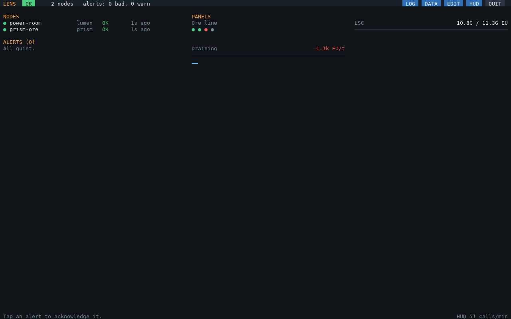
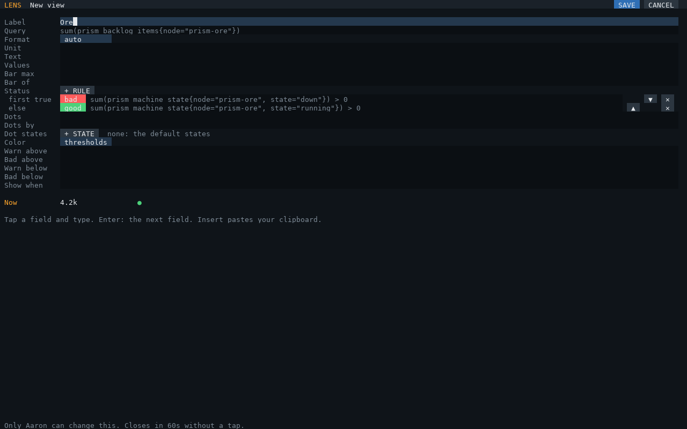

# Views

A **view** is one thing to show: a label, a [query](queries.md) and how it reads. The same view can be a
**panel** on the dashboard and a **bar** or **text line** in the HUD. Views come from `lens-hub.cfg` (`panels`,
and the HUD's elements) and from the screen (EDIT, DATA), together the **library**.

LENS doesn't know what "running" or "overflowing" means: your queries, status rules and states say it, so the
same keys fit power, items or anything an agent sends. [examples.md](examples.md) has ready-made ones.

## Keys

| Key | Meaning |
|---|---|
| `label` | The name shown (required, unique in the library) |
| `value` | A [query](queries.md). Required unless the view has `text`, `status` or `dots`. No data shows `–` |
| `format` | How numbers read: `"auto"` (`4.2k`, `1.5M`, `3G`; the default), `"percent"` (0..1 shown as %, with a bar; `percent = true` is the same), `"duration"` (seconds, as `2h 05m`), `"signed"` (`+2.4k`, `-300`) |
| `unit` | Text after the value |
| `max` | A bar of `value / max` |
| `of` | A query: `value/of`, and a bar of the fraction. `count(...)` of a state series is "how many machines" |
| `color` | How the value and bar are colored: `"thresholds"` (the default: the four keys below), `"sign"` (green above zero, red below), `"status"` (as the status dot), `"none"` |
| `warnAbove`, `badAbove`, `warnBelow`, `badBelow` | Thresholds on the value: yellow or red past them |
| `text`, `values` | **Several values in one line**: `text = "{s} / {c} EU"`, `values = { s = query, c = query }`. Each `{name}` is formatted with `format`; `{value}` and `{of}` are the view's own |
| `status` | **A status dot**: rules in order, `{ level, query }`; the first whose query is true colors the dot, none: `off`. `$value` in a rule is the view's value query |
| `dots`, `by`, `states` | **A dot per item**: a selector, one dot per `by` label (default `machine`), colored by `states` |
| `when` | **Shown only while** this query is true (non-zero). The EDIT page still lists it, as `hidden` |

**Levels** (the colors of dots, status and thresholds): `good` green, `warn` yellow, `bad` red, `off` gray.

## Status dots

```lua
{ label = "Ore", value = 'sum(prism_backlog_items{node="prism-ore"})', unit = "items",
  status = {
    { "bad",  'sum(prism_machine_state{node="prism-ore", state="down"}) > 0' },     -- borked
    { "warn", "$value > 50000" },                                                    -- overflowing
    { "good", 'sum(prism_machine_state{node="prism-ore", state="running"}) > 0' },  -- running smoothly
  } },                                                                               -- none true: gray
```

Rules are tried top to bottom, so the most urgent goes first. The dot leads the label on the dashboard and
follows it in the HUD, with the value on the same row: `Ore ● 4.2k items`. The value keeps its own color unless
`color = "status"`.

## A dot per item

```lua
{ label = "Ore line", dots = 'prism_machine_state{node="prism-ore"}' },        -- one dot per machine
{ label = "LSCs", dots = "lumen_lsc_up", by = "lsc" },                         -- one per LSC: green up, red not
```

`dots` is a [selector](queries.md) (a metric and label filters, no function). Its series are grouped by the
`by` label. A series with a `state` label counts while its value is above 0, colored by `states`:

| `states` default | Level |
|---|---|
| `running`, `ok`, `up`, `on`, `active`, `working` | good |
| `idle`, `waiting` | off |
| `down`, `off`, `bad`, `broken` | bad |
| anything else | warn |

`states = { running = "good", idle = "warn", down = "bad" }` replaces the default. A series without a `state`
label is green above 0 and red at 0. A dot covering several series shows the most severe of them.

## Several values in one line

```lua
{ label = "LSC", text = "{s} / {c} EU", values = { s = "sum(lumen_stored_eu)", c = "sum(lumen_capacity_eu)" } },
{ label = "Power", text = "{i} in {o} out", format = "signed",
  values = { i = "sum(lumen_input_eut)", o = "-sum(lumen_output_eut)" } },
```

## Shown only while

```lua
{ label = "Draining", value = "lumen_net_5m_eut", unit = "EU/t", format = "signed", color = "sign",
  when = "lumen_net_5m_eut < 0" },
```



## The view editor

EDIT (a view's **EDIT**, or **+ NEW**) and DATA (**SAVE AS PANEL**, **ADD TO MY HUD**) open a view in the editor,
with its value previewed as you type:



- **Typing** needs a keyboard attached to the hub's screen. The cursor goes where you tap; ← → move it, Home
  and End jump, Backspace and Delete erase either side, Enter (or ↓) goes to the next field and ↑ back, Insert
  pastes your clipboard.
- **Format** and **Color** cycle when tapped.
- **Values** is typed on one line: `s=sum(lumen_stored_eu); c=sum(lumen_capacity_eu)`.
- **Status:** **+ RULE** adds a rule. Tap its color to cycle good, warn, bad, off; type its query; ▲ ▼ order,
  ✕ removes. Empty rules are dropped.
- **Dot states:** **+ STATE** adds a state: its name, then its color.
- **Now** shows the value, dots and status as they'd look, or what's wrong (the error as you type).
- **SAVE** checks the view like `lens-hub.cfg` would. A view from `lens-hub.cfg` keeps its label; your changes
  are kept in `lens-board.cfg` (**BACK TO lens-hub.cfg** drops them). Renaming a view moves the dashboard and
  players' HUDs along with it.
